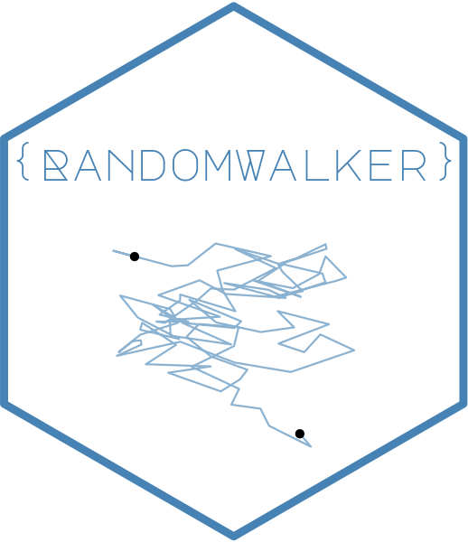

```{r setup, include=FALSE}
knitr::opts_chunk$set(echo = TRUE)
```



<!-- badges: start -->

[](https://cran.r-project.org/package=RandomWalker)   [](https://lifecycle.r-lib.org/articles/stages.html##stable) [](https://makeapullrequest.com)

<!-- badges: end -->

Purpose

The goal of RandomWalker is to provide a consistent verb framework for generating, visualizing, and analyzing random walks of different types.

`RandomWalker` can be found [here](https://www.spsanderson.com/RandomWalker)
